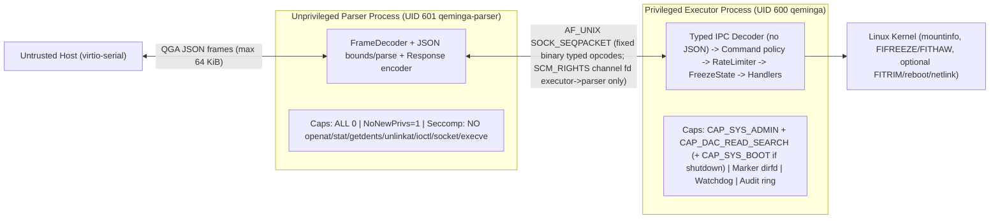

# Isolation Between the Host-Facing Parser and Guest Files (OQ-10)

> **Status:** Design decision for [#68](https://github.com/vicaya/qeminga/issues/68) (parent [#56](https://github.com/vicaya/qeminga/issues/56), `docs/tasks.md` OQ-10).
> **Scope:** Architectural design and verification plan. Implementation is sized in §7 and tracked as follow-up work once this design is accepted.

---

## 1. Problem Statement and Threat Model

In `v1`, `qeminga` runs as a single multi-threaded process after privilege drop (`docs/design.md` §5.4–§5.5, §5.9). That single process simultaneously:

1. Reads and parses adversarial host input from the virtio-serial channel (`/dev/virtio-ports/org.qemu.guest_agent.0`).
2. Holds `CAP_SYS_ADMIN` and `CAP_DAC_READ_SEARCH` (plus `CAP_SYS_BOOT` when `[features] shutdown = true`).
3. Retains file-read and file-write syscalls (`openat`, `read`, `pread64`, `readv`, `readlinkat`, `getdents64`, `write`, `writev`, `pwrite64`, `fsync`, `unlinkat`) in its seccomp-BPF filter.
4. Holds the writable virtio-serial descriptor back to the untrusted hypervisor.

No exploitable parser defect is claimed, and qeminga's safe-Rust bounds (`docs/design.md` §5.2, §5.6) make memory corruption unlikely. However, under a confidential VM (CVM) threat model where the host is untrusted and the defense-in-depth question is **"what happens if a defect compromises the process that parses host input?"**, `v1` cannot prevent a compromised parser from using `CAP_DAC_READ_SEARCH` + `openat`/`read` to read arbitrary guest files (including root-owned mode-`0600` secrets) and writing them to the host channel, nor from manipulating in-process freeze state, watchdogs, rate limiters, or audit records.

This document inventories the minimum authority each component actually needs, compares **Option A (single-process descriptor confinement)** against **Option B (two-process privilege separation with a small privileged typed executor)**, specifies Option B's typed protocol and lifecycle behavior, and defines concrete boundary tests.

---

## 2. Component Authority Inventory

Every operation in `qeminga` touches at most five authority domains. Splitting responsibilities by what each component genuinely requires reveals a clean separation:

| Component | Guest file contents | Mount metadata | Open descriptors | Freeze / thaw / kernel authority | Host channel |
|---|---|---|---|---|---|
| **Host-facing I/O & protocol parser** (framing, `0xFF` sentinel, JSON bounds/parse, QGA reply encoding, virtio disconnect drain) | **None.** Needs zero guest files (not config, not `/etc/os-release`, not `/proc`). | **None.** Never reads `/proc/self/mountinfo`, `/proc/self/fdinfo`, or `statfs`. | Only: `/dev/null` on fds `0`/`1`/`2` (verified by backing device `1:3`, never the executor's inherited `stderr`/journald audit sink), the single verified virtio-serial channel fd (received from executor), and one pre-connected `AF_UNIX` `SOCK_SEQPACKET` IPC fd to the executor. | **None.** Zero capabilities (`CapEff = CapPrm = CapBnd = CapInh = CapAmb = 0`), `PR_SET_PDEATHSIG(SIGKILL)`, no `ioctl`, no `reboot`, no `sync`, no `socket`, no `openat`. | **Read/write** on the open channel fd only; cannot open device paths itself (reopen requests go to executor). |
| **Privileged policy & kernel executor** (config, `Command` allowlist & feature switches, rate limiter, `FreezeStateMachine`, `FreezeOp`, watchdog, marker, `fsfreeze`, optional `fstrim`/`shutdown`/`suspend`/inventory) | Reads `/etc/qeminga/config.toml` at startup; maintains the guest-configured recovery marker (`/run/qeminga/frozen`); reads `/sys/dev/char/<maj>:<min>/name` when verifying the channel device; reads `/etc/os-release` (or `/usr/lib/os-release`) only when `information = true`; writes `/sys/power/state` only when `suspend_ram = true`. Never needs arbitrary workload files. | Reads `/proc/self/mountinfo` (and bounded `/proc/self/fdinfo/<fd>` on Linux 5.4–5.7 when `information = true`); calls `fstat`/`statx(STATX_MNT_ID)` and (when `information = true`) `fstatfs(2)`. | Pinned `/run/qeminga` directory fd; held `O_RDONLY \| O_DIRECTORY` mount descriptors across `Freezing → Frozen → Thawing`; transient `O_PATH` descriptors for `fsinfo`; one IPC socket fd pinned at constant `IPC_FD = 3`; inherited `stderr` journald fd (never shared with parser). Opens `channel_path` transiently only at startup and on authorized reconnect, verifies its character-device identity via `fstat` + sysfs before `SCM_RIGHTS` hand-off, and immediately closes its own copy. | UID/GID `600` (`qeminga`), `CAP_SYS_ADMIN` + `CAP_DAC_READ_SEARCH` (+ `CAP_SYS_BOOT` only with `shutdown = true`; **no `CAP_KILL`**), `ioctl(FIFREEZE/FITHAW)` (+ `FITRIM` with `fstrim = true`), `sendmsg`/`recvmsg` restricted to `arg0 == IPC_FD` in CVM mode, `wait4` for child reaping, `sync`/`reboot` (with `shutdown = true`), `socket(AF_NETLINK, SOCK_RAW\|SOCK_CLOEXEC, NETLINK_ROUTE)` (with `information = true`). | **Never parses host bytes and never writes directly to the channel.** Only passes a newly opened and identity-verified fd for the guest-configured virtio port to the parser via `SCM_RIGHTS`. |
| **Authoritative audit sink** (§9, §9.1) | None (writes structured JSON to inherited `stderr` / journald pipe, switching to the 64 KiB in-memory ring while frozen). | None. | Inherited `stderr` fd owned exclusively by the executor's dedicated audit writer thread (`O_CLOEXEC` / replaced with `/dev/null` in the parser so the parser cannot inject or forge `command_received` records). | None. | None. |

Key observation: **no single component needs both untrusted host-input parsing and `CAP_DAC_READ_SEARCH` / `CAP_SYS_ADMIN` / guest filesystem access.** The host channel only needs to connect to the parser, while filesystem descriptors, mount metadata, capabilities, and stateful lifecycle invariants belong exclusively in the executor.

---

## 3. Comparison of Isolation Options

### 3.1 Option A: Single-Process Descriptor Confinement (`openat2` / Pre-Opened Fds / Landlock)

Option A keeps the parser and privileged handlers in one process and attempts to restrict file access using kernel path/descriptor restrictions: pre-opening fixed directories (`/run/qeminga`, `/etc/qeminga`) at startup, using `openat2(RESOLVE_BENEATH)`, and/or applying a Landlock LSM ruleset (`landlock_restrict_self`).

**Technical blockers and security limits on Linux 5.4+:**

1. **Kernel baseline mismatch (`docs/design.md` §8.5 requires Linux 5.4+):**
   - `openat2(2)` requires **Linux 5.6+**.
   - Landlock ABI v1 requires **Linux 5.13+** (and `CONFIG_SECURITY_LANDLOCK=y`, which is optional in custom guest kernels).
   - On Linux 5.4–5.12, Option A degrades to **zero additional confinement** beyond `v1`.
2. **`openat2(RESOLVE_BENEATH)` is unenforceable by seccomp-BPF inside a compromised process:**
   - `openat2(dirfd, pathname, struct open_how *how, size)` passes `resolve` flags through a user-space pointer. Seccomp-BPF cannot dereference pointers, so a compromised parser can simply pass `how.resolve = 0` or `dirfd = AT_FDCWD`.
   - Even if `openat` were removed and only pre-opened directory fds were used, `FIFREEZE`/`FITHAW` must open dynamically discovered mountpoints across `/` (including mounts attached after daemon startup). Holding a pre-opened `/` `dirfd` lets `openat2(root_fd, "etc/shadow", ...)` read any file under `/`.
   - Channel reconnect reopens `/dev/virtio-ports/org.qemu.guest_agent.0`, which udev creates as a symlink to `../vportXpY` — a `..` traversal that `RESOLVE_BENEATH` relative to `/dev/virtio-ports` rejects.
3. **Landlock (`Linux 5.13+`) still leaks guest metadata and cannot protect process integrity:**
   - Landlock separates `LANDLOCK_ACCESS_FS_READ_DIR` from `LANDLOCK_ACCESS_FS_READ_FILE`. Withholding `READ_FILE` on `/` while granting `READ_DIR` on `/` allows opening mountpoint directories for `FIFREEZE` while blocking regular-file reads under `/` — **only** in the CVM profile (`information = false`) and **only** on Linux 5.13+.
   - Even there, granting `READ_DIR` on `/` allows a compromised parser to enumerate **every directory and filename on the entire guest** (`getdents64`) and exfiltrate them over the host channel.
   - Reading `/proc/self/mountinfo` (required for every freeze/recovery) and `/etc/os-release` (when `information = true`) forces granting `READ_FILE` either on `/proc`/`/etc` (exposing `/etc/shadow`, SSH host keys, or `/proc/*/environ` via `CAP_DAC_READ_SEARCH`) or on inode-pinned file rules that break on atomic rename/package upgrade or per-process `/proc/self` lookup.
   - Most fundamentally, the compromised parser still shares an address space with `CAP_SYS_ADMIN`, `CAP_DAC_READ_SEARCH`, `ioctl(FIFREEZE/FITHAW)`, the marker fd, `FreezeStateMachine`, the watchdog timer, rate limiters, and the audit ring. It can bypass all command gates, hold filesystems frozen without arming the watchdog, suppress audit records, or corrupt `/run/qeminga/frozen`.

### 3.2 Option B: Two-Process Privilege Separation (Zero-Privilege Parser + Small Privileged Typed Executor)

Option B splits `qeminga` into two OS processes with disjoint address spaces, disjoint UIDs, disjoint capability sets, and disjoint seccomp-BPF filters, communicating strictly through a typed, bounded `AF_UNIX` `SOCK_SEQPACKET` socketpair:



- **Untrusted parser (`qeminga-parser`, UID/GID `601`):**
  - Spawned once at startup via `fork` + `execve` (before the executor drops privileges and installs its seccomp filter) with `O_CLOEXEC` on every executor descriptor and `/dev/null` bound to fds `0`, `1`, and `2` before `execve`, so the parser inherits **zero** executor memory, **zero** ASLR layout, **no access to the executor's `stderr`/journald authoritative audit stream**, and **only** `/dev/null` (`0`/`1`/`2`), the IPC socket fd, and the initial verified channel fd (if open). After `execve` and after dropping to UID `601` and zero capabilities (since credential transitions clear `pdeath_signal` on Linux) — and before installing its seccomp filter — the parser sets `PR_SET_PDEATHSIG(SIGKILL)` and checks `getppid() == expected_executor_pid` to close the parent-death race, ensuring parent exit terminates it even if uncooperative. Structured parse-rejection observations travel over `ReportParseRejection` and are logged by the executor as untrusted parser observations, distinct from executor-admitted operations. (If unstructured parser crash/panic diagnostics are ever captured in a future revision, they must be routed over a separate bounded pipe read by the executor and logged under a distinct, explicitly untrusted diagnostic event — never sharing the authoritative `stderr` audit fd.)
  - Runs as a dedicated account (`qeminga-parser`, UID/GID `601`, distinct from `qeminga` UID/GID `600`) so it has zero discretionary access to `/run/qeminga` (`0700 qeminga:qeminga`), `/dev/virtio-ports/org.qemu.guest_agent.0` (`0600 qeminga:qeminga`), or optional `/sys/power/state` (`0664 root:qeminga`).
  - Drops **all** capabilities (`CapEff = CapPrm = CapBnd = CapInh = CapAmb = 0`), sets `PR_SET_NO_NEW_PRIVS`, changes working directory to an empty read-only directory (or `/`), caps `RLIMIT_NOFILE`, and installs a **parser seccomp filter** that **omits all filesystem-opening, filesystem-mutation, socket-creation, process-execution, and kernel-ioctl syscalls** (`open`, `openat`, `openat2`, `creat`, `stat*`, `newfstatat`, `statx`, `getdents64`, `readlinkat`, `faccessat*`, `unlinkat`, `fsync`, `ioctl`, `socket`, `socketpair`, `connect`, `bind`, `listen`, `accept*`, `sendto`, `recvfrom`, `execve`, `execveat`, `reboot`, `sync`, `uname`, `statfs`, `fstatfs`).
  - The parser needs only: `read`/`write`/`readv`/`writev`/`close`, `recvmsg`/`sendmsg` (on its single pre-connected `SOCK_SEQPACKET` IPC fd, receiving `SCM_RIGHTS` channel fds), `ppoll`/`epoll_*`/`eventfd2`, `fcntl`, memory/thread/futex/clock/exit syscalls. (Because the executor owns `SIGTERM`/`SIGINT` handling and signals session end by closing the IPC socket, the parser does not even need a signal `socketpair`.)
- **Privileged executor (`qeminga`, UID/GID `600`):**
  - Retains the existing §5.4–§5.5 privilege drop and authority-derived seccomp filter (`CAP_SYS_ADMIN`, `CAP_DAC_READ_SEARCH`, optional `CAP_SYS_BOOT`; **never `CAP_KILL`**; `execve`/`execveat` absent after startup; systemd `ProtectSystem=strict` + `ReadWritePaths=-/run/qeminga` from #66; narrowed socket rules from #67), with three explicit additions for the IPC, channel-identity, and child-supervision boundary:
    - **Reserved IPC descriptor (`IPC_FD = 3`):** Before dropping privileges and installing seccomp, the executor `dup2`s its end of the IPC `SOCK_SEQPACKET` socketpair onto constant fd `3` (`IPC_FD`) and closes the original fd. In the CVM profile (`information = false`), the executor's seccomp filter adds `sendmsg` and `recvmsg` **restricted by `arg0 == IPC_FD` (`dword`)** so `SCM_RIGHTS` channel handoff and ancillary-data inspection work while `sendmsg`/`recvmsg` remain unavailable on any other descriptor. (When `information = true`, `sendmsg`/`recvmsg` remain available for netlink as well.)
    - **Channel sysfs subsystem verification (`readlinkat`):** The executor's seccomp profile adds `readlinkat` so it can read the `/sys/dev/char/<major>:<minor>/subsystem` symlink on every initial open and `RequestChannelReopen` (§4.2) alongside `openat`/`read` of `name`.
    - **Reaping and cross-UID termination without `CAP_KILL`:** The executor's seccomp profile adds `wait4` so it can reap the parser child (`WNOHANG` or on exit). Because UID `600` intentionally does **not** hold `CAP_KILL` (which would grant kill authority over every process in the guest, including `root`), the executor enforces termination on protocol violation by immediately closing `IPC_FD` and relying on `PR_SET_PDEATHSIG(SIGKILL)` plus systemd's `KillMode=control-group` (detailed in §5.3).
  - Never parses JSON and never reads from or writes to the virtio channel (closes its copy of the verified channel fd immediately after handing it to the parser via `SCM_RIGHTS`).
  - Independently enforces `Command::is_enabled(&authority)`, guest-owned freeze mount target policy (#63), per-class rate limits, freeze state machine, watchdog, recovery marker, and authoritative `command_received` audit records for every operation the executor observes (sole writer to the inherited `stderr`/journald audit stream).

### 3.3 Property Matrix: What Each Option Actually Enforces

| Security property (assuming arbitrary code execution inside the host-facing parser) | `v1` (current single process + #66 + #67) | Option A (single-process `openat2` / Landlock) | Option B (two-process parser + typed executor) |
|---|---|---|---|
| **Works on full supported Linux 5.4+ baseline (§8.5)** | Yes | **No** (`openat2` needs 5.6+; Landlock needs 5.13+) | **Yes** (standard `AF_UNIX` `SOCK_SEQPACKET`, `SCM_RIGHTS`, seccomp-BPF, `PR_SET_PDEATHSIG`) |
| **Confidentiality of root-owned `0600` guest secrets (CVM & inventory)** | **No** (`CAP_DAC_READ_SEARCH` + `openat`/`read` in parser) | Linux 5.4–5.12: **No**. Linux 5.13+ CVM: regular-file content under `/` blocked, `/proc` & `/etc` fragile | **Yes** — parser has UID `601`, zero caps, and no `openat`/`readlinkat`/`getdents64` syscalls |
| **Confidentiality of world-readable guest files & directory listings** | **No** | **No** (`READ_DIR` on `/` exposes all filenames) | **Yes** — parser cannot open or list any directory or file |
| **Integrity of ordinary guest files (incl. UID-600-writable files)** | Bounded by systemd `ProtectSystem=strict` (#66), except `/run/qeminga` | Linux 5.13+ only; still allows `/run/qeminga` | **Yes** — parser has no `openat`/`unlinkat`, distinct UID `601`, and zero write paths |
| **Integrity of `/run/qeminga/frozen` marker, `FreezeState`, watchdog, rate limiter, and executor-observed audit trail** | **No** (all live in parser address space) | **No** (all live in parser address space) | **Yes** — all live exclusively in executor address space; parser has `/dev/null` on fds `0`/`1`/`2` (never the executor's `stderr` audit sink), so it cannot forge `command_received` records, alter or suppress audit records of executor-admitted operations, or bypass executor controls |
| **Enforcement of guest command allowlist & freeze target policy** | Bypassable after parser compromise | Bypassable after parser compromise | **Yes** — executor independently authorizes every typed operation against guest config |
| **Residual exposure if parser is compromised** | Full file read + channel exfil, marker/state tampering, `CAP_SYS_ADMIN` ioctls | Directory enumeration, state/watchdog/marker tampering, `CAP_SYS_ADMIN` ioctls | Only valid policy-authorized typed operations the host could already send (rate-limited and audited by executor), the tiny non-JSON binary IPC parser in executor, and **host-facing wire replies / dropped raw frames / parser-reported parse-rejection diagnostics** (§3.4) |

### 3.4 Residual Limits: Wire Replies, Controller Trust (§4.5), and Parser Observations

Option B isolates guest files, kernel authority, freeze state, and the guest's authoritative audit sink, but **a compromised parser still owns the writable host channel and QGA JSON framing**. Two trust boundaries therefore remain distinct and must not be conflated:

1. **Who can vouch for a freeze or thaw result (§4.5 controller contract):** The executor can vouch for every operation it actually admitted and its true kernel outcome in the guest's local audit stream. Because the parser encodes QGA JSON replies on the virtio channel, a compromised parser can emit a fabricated wire reply (such as a fake `{"return": 2}` freeze/thaw count or `"frozen"` status) without invoking the executor, or alter a real executor reply before sending it. A trustworthy guest-local audit record of executor decisions and an authenticated end-to-end snapshot acknowledgement to a backup controller are therefore **different guarantees**: the §4.5 controller protocol trusts the parser's QGA replies unless a separate end-to-end authentication mechanism (for example, executor-signed acknowledgements or guest attestation) is added.
2. **Scope of audit-trail integrity (`ReportParseRejection` vs. executor decisions):** The executor guarantees audit integrity for **every operation that reaches the executor** (every admitted/denied IPC request and its kernel outcome). Because only the parser reads raw bytes from the virtio channel, a compromised parser can drop raw host frames before IPC or send fabricated `ReportParseRejection` messages. The executor therefore logs `ReportParseRejection` under a distinct event/field explicitly marked as an **untrusted parser observation** (rate-bounded and separate from executor-authored `command_received` decisions) so auditors and controllers know exactly which records are authoritative executor facts.

---

## 4. Trusted Authorization and Typed IPC Protocol (Option B)

### 4.1 Wire Format, Chunking, and Strict §5.10 Bounds

Communication over the `AF_UNIX` `SOCK_SEQPACKET` socketpair uses a minimal, non-recursive, versioned binary chunk protocol (`src/ipc.rs`) that preserves every existing wire limit of `docs/design.md` §5.10 without depending on oversized socket buffers (`SO_SNDBUF`/`SO_RCVBUF`):

```text
Chunk := version(u8 = 1)
       | session_gen(u64 LE)
       | req_id(u64 LE)
       | opcode_or_status(u8)
       | flags(u8: bit 0 = MORE_CHUNKS; other bits must be 0)
       | chunk_seq(u16 LE: 0, 1, 2, ...)
       | payload_len(u16 LE <= 32768)
       | payload(payload_len bytes)
```

- **Per-packet and assembled payload bounds (preserving §5.10 exactly):**
  - **Per-packet cap:** Every individual `SOCK_SEQPACKET` message carries at most **`32 KiB`** of payload (`32,768` bytes + `23`-byte header), well below Linux's default `SO_SNDBUF`/`SO_RCVBUF` on every supported kernel. Almost all commands fit in a single chunk (`flags = 0`, `chunk_seq = 0`).
  - **Parser → executor assembled request cap:** **`64 KiB`** (`65,536` bytes, at most 2 chunks), matching §5.10's input frame bound. `FsfreezeFreezeList` carries **no independent 256-entry count limit** (matching §5.10's "the frame: no count of its own"): each mountpoint string is capped at `4,096` bytes (§5.2) and encoded as `len(u16 LE) + utf8 bytes` (`len + 2` bytes), which is strictly smaller than the smallest legal JSON array element (`"...",`, at least `len + 3` bytes). Every legal 64 KiB JSON `guest-fsfreeze-freeze-list` frame therefore fits inside the 64 KiB binary IPC request payload regardless of entry count.
  - **Executor → parser assembled response cap:** **`1 MiB`** (`1,048,576` bytes, at most 32 chunks) for `GetFsInfo` (matching §5.10 and `src/handlers/fsinfo.rs`'s `MAX_FSINFO_REPLY_BYTES`) and for opted-in `Fstrim` (an explicit new bound to be added alongside §5.10 when OQ-10 is implemented, covering large multi-mount discard tables), **`256 KiB`** (at most 8 chunks) for `NetworkGetInterfaces` (§5.10), and smaller fixed caps (single chunk ≤ `32 KiB`) for all other opcodes.
  - **Final QGA wire limit enforcement & opted-in `Fstrim` oversize behavior:** The executor checks the conservative JSON wire size budget before emitting large inventory or trim DTOs (matching today's `fsinfo.rs` / `interfaces.rs` checks), and the parser verifies that the final serialized QGA JSON line (including `{"return":...,"id":...}\n`) does not exceed the bound (`1 MiB` for `guest-get-fsinfo` and `guest-fstrim`, `256 KiB` for `guest-network-get-interfaces`), returning `GenericError` naming the bound and never truncating. For opted-in `Fstrim`, because `FITRIM` kernel discards have already completed by the time the response is assembled, an oversized valid trim result must **never** be treated as an `ipc_protocol_violation` and must leave the IPC session and executor state intact: the executor logs the full per-path trim summary locally and sends a single small `Err(ErrorCode::FstrimReplyTooLarge { completed_targets: u64, limit_bytes: 1_048_576 })` packet, which the parser maps to a fixed QAPI `GenericError` (`"fstrim completed on N target(s), but reply exceeds the 1 MiB response bound"` — acknowledging completed side effects without emitting partial or truncated paths).
  - **Concurrency cap:** Maximum **`8`** concurrent in-flight `(session_gen, req_id)` streams (matching §5.10 session places; excess requests are rejected without allocating).
- **Session binding (`session_gen` + `req_id`):** Every request and response carries the parser's monotonic `session_gen` (incremented on every channel open, reopen, or disconnect boundary; §5.2) and a non-reused `req_id`.
- **Truncation, ancillary-data (`MSG_CTRUNC`), and malformed-IPC rejection:** Both peers always pass `MSG_CMSG_CLOEXEC` to `recvmsg` with a non-zero control buffer (`CMSG_SPACE(sizeof(int))`) and inspect **both** `msghdr.msg_flags & MSG_TRUNC` **and** `msghdr.msg_flags & MSG_CTRUNC` before parsing or dispatching any payload. Every control message (`CMSG_FIRSTHDR`/`CMSG_NXTHDR`) is walked on every packet so that **every** descriptor received in `SCM_RIGHTS` is immediately closed on any rejection path (preventing descriptor leaks):
  - **Executor receiving from parser:** **Zero** control messages are allowed on any parser → executor packet. Any `MSG_CTRUNC` or `msg_controllen > 0` (any ancillary data, `SCM_RIGHTS` or otherwise) closes all received descriptors, logs `ipc_protocol_violation`, and immediately disconnects and initiates parser termination (§5.3) without dispatching.
  - **Parser receiving from executor:** `MSG_CTRUNC` is always fatal (close any received descriptors and treat as a protocol violation). On `OkChannelFd` (`chunk_seq == 0`), the parser requires **exactly one** control message with `cmsg_level == SOL_SOCKET`, `cmsg_type == SCM_RIGHTS`, and payload length equal to `sizeof(int)` (exactly 1 valid fd), rejecting 0 fds, >1 fds, unknown/extra control messages, or `MSG_CTRUNC` (closing all received fds on rejection). On every other executor → parser opcode or continuation chunk, the parser requires `msg_controllen == 0` and `!MSG_CTRUNC` (closing any unexpected fds and rejecting the packet).
  - **Structural validation:** Any `MSG_TRUNC`, `payload_len` mismatch against packet length, unknown `version`/`opcode`/flag bit, out-of-order `chunk_seq`, mismatched `(session_gen, req_id, opcode)` across chunks, cumulative payload exceeding the operation's cap, or trailing bytes likewise triggers immediate `ipc_protocol_violation`, disconnect, and termination (§5.3) without partial dispatch or truncated replies.

### 4.2 Typed Operations (Explicitly Excluding General Proxies)

Every operation is a closed enum variant authorized independently by the executor against its own `Config::authority()`, `RateLimiter`, `FreezeStateMachine`, and guest target policy:

| Opcode | Request payload (parser → executor) | Executor authorization & target binding | Response payload (executor → parser) |
|---|---|---|---|
| `Ping` | empty | Rate limit (`PingSync`), audit | `OkEmpty` |
| `Info` | empty | Rate limit (`PingSync`), audit | Static `Vec<(CommandId, enabled, success_response)>` derived from executor's `Config::authority()` |
| `Sync { id: i64 }` | `i64` | Rate limit (`PingSync`), audit | `OkI64(id)` |
| `SyncDelimited { id: i64 }` | `i64` | Rate limit (`PingSync`), audit | `OkI64(id)` (parser prefixes `0xFF`) |
| `FsfreezeStatus` | empty | Unlimited, watchdog heartbeat if `Frozen`, audit | `OkFreezeStatus(Thawed \| Frozen)` |
| `FsfreezeFreeze` | empty | Freeze gate, rate limit (`FsfreezeFreeze`), guest mount policy (see #63 below), audit | `OkCount(u64)` or `Err(FixedErrorCode)` |
| `FsfreezeFreezeList` | `has_list(u8: 0 = omitted, 1 = present)`, when `1`: `count(u16)` + `count` entries of `len(u16 <= 4096) + utf8 bytes` (total payload ≤ `64 KiB`, no separate count cap) | Freeze gate, rate limit (`FsfreezeFreeze`), explicit omitted/empty/list mount policy (see #63 below), `st_dev` verification on `O_RDONLY \| O_DIRECTORY`, audit | `OkCount(u64)` or `Err(FixedErrorCode)` |
| `FsfreezeThaw` | empty | Unlimited, joins active `FreezeOp` or runs tracked/discovery drain covering every executor-owned freeze (see #63 & #69 below), audit | `OkCount(u64)` or `Err(FixedErrorCode)` |
| `GetOsInfo` | empty | **Requires `authority.information`**, freeze gate, rate limit (`Get`), audit | Bounded `OsInfoDto` or `Err(Disabled \| Frozen \| ...)` |
| `NetworkGetInterfaces` | empty | **Requires `authority.information`**, freeze gate, rate limit (`Get`), audit | Bounded `Vec<InterfaceDto>` (≤ `256 KiB` chunked; loopback & link-local already stripped by executor) |
| `GetFsInfo` | empty | **Requires `authority.information`**, freeze gate, rate limit (`Get`), audit | Bounded `Vec<FsInfoDto>` (≤ `1 MiB` chunked; visible UTF-8 mounts with opaque `fs-N` IDs & `POLLPRI`-checked sizes) |
| `Fstrim { minimum: u64 }` | `u64` | **Requires `authority.trim`**, freeze gate, rate limit (`Fstrim`), audit | Bounded `Vec<TrimPathDto>` (≤ `1 MiB` chunked; fixed open-failure reasons) or `Err(FstrimReplyTooLarge { completed_targets, limit_bytes })` |
| `Shutdown { mode }` | `mode(u8: Powerdown \| Halt \| Reboot)` | **Requires `authority.reboot`**, freeze gate, rate limit (`Shutdown`), flush audit, `sync`+`reboot` | `OkSilent` (no reply on success) or `Err(...)` |
| `SuspendRam` | empty | **Requires `authority.suspend`**, freeze gate, rate limit (`Shutdown`), writes `/sys/power/state`, audit | `OkSilent` or `Err(...)` |
| `ReportParseRejection` | `kind(u8: Oversized \| ParseError \| UnknownMethod)`, bounded metadata | Rate-bounded executor audit entry logged explicitly as an **untrusted parser observation** (§3.4); no kernel work | `OkAck` |
| `RequestChannelReopen` | empty | Executor enforces §5.7 reopen backoff (1 s → 30 s), opens `config.agent.channel_path`, checks `EBUSY` terminal rule (§8.4), verifies backing character-device identity (`fstat` + sysfs `virtio-ports` subsystem & port name, below), sends exact single fd via `SCM_RIGHTS` over `IPC_FD`, closes own copy | `OkChannelFd` (+ 1 `SCM_RIGHTS` fd) or `Err(RetryLater \| TerminalBusy)` |

**Mount-policy semantics across every freeze/thaw form (open decision: [#63](https://github.com/vicaya/qeminga/issues/63); multi-freezer ownership: [#69](https://github.com/vicaya/qeminga/issues/69)):**
The disclosure policy for unprovisioned mounts in the CVM profile is tracked in #63, and multi-freezer per-target ownership is tracked in #69 (OQ-11). Option B's IPC schema preserves every request distinction so the executor can enforce both cleanly:
- **`FsfreezeFreezeList` with `has_list = 0` (omitted `mountpoints` field in JSON):** selects the same target set as whole-guest **`FsfreezeFreeze`** (all eligible superblocks under unrestricted visibility, or restricted to the guest-configured allowlist when a guest-enforced allowlist is active under #63).
- **`FsfreezeFreezeList` with `has_list = 1, count = 0` (explicit `mountpoints: []`):** selects zero targets under either policy (zero-work operation, settles `Thawed` with `0`).
- **`FsfreezeFreezeList` with `has_list = 1, count > 0` (including aliases and mixed selections):** under unrestricted visibility, resolves against `FreezePlan::restrict_to` as in `v1`; under a guest-enforced allowlist (#63), the executor filters requested names against the guest allowlist **before** mountinfo lookup so unauthorized names produce a guest-independent `0` (indistinguishable from unmounted) and mixed selections freeze and count only the authorized subset.
- **`FsfreezeThaw` (tracked, `Thawed` recovery, and crash/marker recovery across configuration changes):**
  - *Tracked thaw (`ThawScope::Tracked`):* drains only the descriptors held by the executor from the completed operation (already admitted under the active policy) and reports their thawed count.
  - *`Thawed` recovery drain (no `/run/qeminga/frozen` marker, no prior crash obligation):* when a guest-enforced allowlist (#63) is active, restricts discovery strictly to superblocks authorized by the current policy (never opening, thawing, or counting unprovisioned superblocks); when #69 ownership is enabled, drains only superblocks explicitly owned by qeminga.
  - *Marker / restart recovery (`Frozen` + `ThawScope::Discovery` with `/run/qeminga/frozen` present):* v1's bare marker carries no target identities or policy version, so if guest configuration narrowed the mount policy between freeze and restart, draining only targets in the *current* policy could strand a previously owned freeze and remove the marker prematurely. Therefore:
    1. **Under v1's sole-freezer assumption (before #69 per-target ownership is enabled):** marker recovery performs a full discovery drain over **all** eligible superblocks in the mount table (using aliases if a primary mountpoint was overmounted), removes `/run/qeminga/frozen` **only** once every eligible superblock has drained cleanly (retaining the marker and `Frozen` state on any unreachable target or incomplete drain, emitting only a fixed host-safe `ErrorCode`), and filters the count sent over IPC and on the wire (in both success and error replies) strictly to superblocks authorized by the **current** guest policy (logging the full internal drained count only in guest-local executor audit logs).
    2. **Once #69 (OQ-11) per-target ownership is enabled (supporting a second in-guest freezer):** marker recovery consults the guest's durable per-superblock ownership records instead of a broad discovery drain, draining **only** `OwnedBySelf` superblocks (surviving policy narrowing without touching foreign freezers), removing `/run/qeminga/frozen` only when every `OwnedBySelf` superblock has drained and ownership is unambiguous, and still filtering the count reported over IPC and on the wire to the current guest policy.

**Channel descriptor identity verification (initial open and every `RequestChannelReopen`):**
Opening `config.agent.channel_path` by name alone is insufficient to guarantee that an ordinary file or unrelated character device fd never crosses IPC, and a driver-defined sysfs `name` attribute alone does not prove the device's subsystem class. Before passing any channel descriptor to the parser (at startup or via `SCM_RIGHTS`), the executor verifies the **opened descriptor** itself with the same identity predicate as `packaging/udev/99-qeminga.rules` (`SUBSYSTEM=="virtio-ports"`, `ATTR{name}=="org.qemu.guest_agent.0"`), eliminating path TOCTOU:
1. Call `fstat(fd)` and require `S_ISCHR(st_mode)`. Any regular file, directory, symlink, FIFO, socket, or block device is immediately closed and rejected.
2. In production (`hardening = "enforced"`), extract `(major, minor)` from `fstat(fd).st_rdev`, pin the sysfs device directory via `open("/sys/dev/char/<major>:<minor>", O_RDONLY | O_DIRECTORY | O_CLOEXEC)` (compatible with `ProtectKernelTunables=yes` / `BindReadOnlyPaths=/sys` from #66 and CVM seccomp), and verify **both**:
   - `readlinkat(dirfd, "subsystem")` succeeds and its final path component equals `"virtio-ports"` (`SUBSYSTEM=="virtio-ports"`), **and**
   - `openat(dirfd, "name", O_RDONLY | O_NOFOLLOW | O_CLOEXEC)` (bounded read) succeeds and its exact content matches the guest-configured virtio-serial port name (`org.qemu.guest_agent.0\n`).
   If any sysfs record is missing, unreadable, mismatched, or disappears mid-check during hotplug (`ENOENT`/`ENODEV`), the executor **fails closed**: closes `fd`, sends no `SCM_RIGHTS` descriptor, and treats the attempt as a failed open/reopen (never falling back to path-only or name-only checks). This stays valid across udev symlinks (`/dev/virtio-ports/org.qemu.guest_agent.0 -> ../vportXpY`) and hotplug `vportXpY` minor renumbering while rejecting regular files, unrelated character devices (`/dev/mem`, `/dev/kmsg`, `/dev/null`), and non-`virtio-ports` drivers that happen to expose a `name` attribute.
3. In test/development harnesses using a PTY slave (`devpts`), allow `S_ISCHR(st_mode)` + `fstatfs(fd) == DEVPTS_SUPER_MAGIC` + `isatty(fd)` only when explicitly enabled for test harnesses (never regular files or arbitrary character devices).

**Explicitly excluded proxy anti-patterns:**
- **No path proxy:** There is no opcode that reads, stats, lists, opens, writes, or unlinks a parser-chosen path. `FsfreezeFreezeList` strings are strictly filtered by the executor's guest-owned policy and `FreezePlan::restrict_to` (only local ext4/xfs superblocks, `FIFREEZE` only) and never yield file contents or path names back to the parser.
- **No descriptor proxy:** No filesystem, `/proc`, marker, or netlink descriptor ever crosses IPC. `SCM_RIGHTS` flows strictly executor → parser over `IPC_FD` and carries **only** an identity-verified channel character-device fd opened from `config.agent.channel_path`. Both peers enforce `MSG_CMSG_CLOEXEC` and `MSG_CTRUNC` checks and close every descriptor received on any rejected packet (§4.1).
- **No syscall / ioctl proxy:** No generic `ioctl`, `netlink`, `open`, or `signal` forwarding exists.
- **No arbitrary error strings in CVM mode:** Error responses carry a closed `ErrorCode` enum + counts (`u64`) + recovery-state enum, so the parser formats fixed QAPI strings (`docs/design.md` §5.9, AC27) and the executor never ships diagnostic strings containing guest paths or device numbers across the boundary.

---

## 5. Lifecycle, Mount Changes, Reconnect, Recovery, and Profile Differences

### 5.1 Mount Changes
All `/proc/self/mountinfo` snapshots, visibility resolution (`MountTree`), `O_RDONLY | O_DIRECTORY` opens, `fstat`/`statx(STATX_MNT_ID)` identity checks, `ppoll(POLLPRI)` namespace-change checks, and held frozen descriptors stay inside the executor. Mounts added, removed, or overmounted at runtime work identically to `v1` without granting the parser any filesystem visibility.

### 5.2 Channel Reconnect, Late IPC Replies, and Transport Reset
1. **Host disconnect without reset (`POLLIN | POLLHUP`, no `POLLOUT`):** Handled inside the parser on its existing channel fd (abandon undelivered replies, drain unread stale bytes to EOF/`EAGAIN`, `ppoll` backoff until `HostState::Ready`, matching §5.7). Because the IPC socket survives across this boundary, the parser **increments its monotonic `session_gen`** on every disconnect/EOF/reopen boundary and retires all outstanding `(old_gen, req_id)` entries.
2. **Binding late executor replies to their originating session:** Preserving §5.7, the executor still runs every already-accepted IPC operation to completion (updating `FreezeState`, `/run/qeminga/frozen`, watchdog, and authoritative audit records) and sends its IPC response tagged with the originating `(session_gen, req_id)`. If that response arrives after the parser has moved to a newer `session_gen`, the parser drains all chunks of the stale response and **discards it without writing anything to the new host session**, so a replacement controller never receives a previous controller's reply even if QGA `id` values are reused.
3. **Deferred initial open, hot-unplug (`POLLHUP`), closed peer (`POLLERR`/`POLLRDHUP`), or `NeedsBoundary` transport reset:** The parser closes its stale channel fd, increments `session_gen`, and sends `RequestChannelReopen`. The executor opens `config.agent.channel_path` as UID `600` (`qeminga`), enforces backoff, verifies backing character-device identity (§4.2), returns the fd via `SCM_RIGHTS` over `IPC_FD`, and closes its own copy.
4. **Terminal `EBUSY` (§8.4):** The executor detects `EBUSY` itself during open/reopen, closes `IPC_FD` to end the parser session, waits until `FreezeState == Thawed` (bounded by the watchdog if frozen), and exits with `EX_UNAVAILABLE` (69).

### 5.3 Recovery Marker, Watchdog, and Parser Supervision (Without `CAP_KILL`)
- **Startup recovery:** The executor checks `Marker::exists()` before spawning the parser, enters `Frozen` recovery mode, switches the audit router to ring mode, and arms the watchdog immediately (OQ-7, C-14) — completely independent of whether the parser or channel is ready.
- **Parser crash, seccomp kill, or `ipc_protocol_violation` while `Thawed`:** The executor closes `IPC_FD`, reaps the child via `wait4` if already exited, and exits non-zero. Both `PR_SET_PDEATHSIG(SIGKILL)` (armed by the parser before entering its serving loop) and systemd's `KillMode=control-group` (default) immediately terminate any non-cooperating UID-601 parser without granting `CAP_KILL` to UID `600`, and `Restart=always` starts a fresh pair with new ASLR.
- **Parser crash, seccomp kill, or `ipc_protocol_violation` while `Freezing` / `Frozen` / `Thawing`:** The executor **never exits while filesystems may be frozen** (§5.7). On `EOF` or `ipc_protocol_violation`, the executor immediately closes `IPC_FD` (severing all executor authority — the parser can submit zero opcodes and cannot request channel reopen), reaps the child via `wait4(WNOHANG)` if dead, and keeps `FreezeState`, held descriptors, `/run/qeminga/frozen`, and the watchdog intact. Once the watchdog (or in-flight drain) completes the thaw and removes `/run/qeminga/frozen`, the executor exits non-zero, at which point `PR_SET_PDEATHSIG(SIGKILL)` and systemd's `KillMode=control-group` immediately kill any remaining non-cooperating parser and restart the unit cleanly. This keeps `execve`/`fork` and `CAP_KILL` completely absent from the executor after startup. *(Residual window noted explicitly: during that bounded thaw drain after a protocol violation while `Frozen`, an uncooperative parser still retains its existing open channel fd until the executor finishes thawing and exits, though it has zero access to the executor; if instant mid-freeze kill or parser respawn ahead of the 30 s idle watchdog were ever required without `CAP_KILL`, the same IPC protocol can run across two companion systemd units — `qeminga.service` and `qeminga-parser.service` — connected via a private `0750 root:qeminga-parser` `SOCK_SEQPACKET` socket verified by `SO_PEERCRED`.)*
- **Executor crash (`SIGKILL`):** `PR_SET_PDEATHSIG(SIGKILL)` kills the parser immediately (and it also exits on IPC `EOF`); systemd restarts the service and `/run/qeminga/frozen` drives conservative marker recovery exactly as in `v1` (§4.4).

### 5.4 CVM vs. Opted-In Inventory Profiles
- **CVM / data-protection profile (`packaging/config-data-protection.toml`):**
  - Parser sandbox is identical: UID `601`, zero capabilities, `PR_SET_PDEATHSIG(SIGKILL)`, zero filesystem syscalls.
  - Executor drops `CAP_SYS_BOOT` (and never holds `CAP_KILL`), omits `reboot`/`sync`/`uname`/`statfs`/`fstatfs`/netlink/`socket`/`FITRIM` from its seccomp filter, restricts `sendmsg`/`recvmsg` to `arg0 == IPC_FD` (`3`) plus `readlinkat` (for sysfs `subsystem` verification) and `wait4` (for child reaping), denies all inventory/trim/shutdown/suspend IPC opcodes with `ErrorCode::Disabled`, enforces the #63 mount policy on freeze/thaw, and emits only fixed enums and `u64` counts over IPC.
- **General-VM / opted-in inventory profile (`packaging/config.toml`):**
  - Parser sandbox remains **unchanged** (UID `601`, zero capabilities, zero filesystem syscalls). Even when `information = true`, a compromised parser still cannot read arbitrary guest files outside the explicitly authorized `OsInfo`/`Interface`/`FsInfo` projections collected and filtered by the executor.
  - Executor retains only the configured authority (`information`, `fstrim`, `shutdown`, optional `suspend_ram`) plus `IPC_FD` IPC, `readlinkat`, and `wait4`, matching §5.9.

---

## 6. Verifiable Boundary Test Specification

Before claiming OQ-10 isolation in any release, the implementation must pass these automated privileged / disposable-guest boundary tests against the real built binary under enforced hardening (including the enforcing **CVM executor seccomp filter**):

### Test Fixtures (present simultaneously in the guest)
1. **Synthetic guest secrets:**
   - `/var/lib/qeminga-boundary-test/root-secret` (`0600 root:root`, containing `"synthetic-root-secret-oq10"`).
   - `/var/lib/qeminga-boundary-test/world-secret` (`0644 root:root`, containing `"synthetic-world-secret-oq10"`).
2. **Unrelated writable files:**
   - `/tmp/qeminga-boundary-uid600` (`0600 qeminga:qeminga`, initial content `"untouched-uid600"`).
   - `/tmp/qeminga-boundary-world` (`0666 root:root`, initial content `"untouched-world"`).
3. **Authorized freeze targets:** Real loop-mounted `ext4` (and `xfs`) filesystems, including a mode-`0700 root:root` mountpoint to verify the executor's `CAP_DAC_READ_SEARCH` still opens protected mountpoints.

### Required Automated Checks
1. **Parser process credential, backing-object descriptor & seccomp inspection:** Read `/proc/<parser_pid>/task/*/status` for every thread of the parser child and assert `Uid == 601`, `CapEff == CapPrm == CapBnd == CapInh == CapAmb == 0000000000000000`, `NoNewPrivs == 1`, `Seccomp == 2`. Verify fds `0`/`1`/`2` by their **backing kernel object** (`fstat` proving `S_ISCHR` with `rdev == (1, 3)` `/dev/null` and `(st_dev, st_ino)` distinct from `/proc/<executor_pid>/fd/2`), and verify `/proc/<parser_pid>/fd` contains **only** `/dev/null` (`0`/`1`/`2`), the verified channel char device, the single IPC socket, and epoll/eventfd descriptors (no executor `stderr` audit fd, no marker dirfd, no mount fds, no `/proc/self/mountinfo`).
2. **Confidentiality boundary probe (synthetic secrets):** Execute a child test harness under the exact parser sandbox (UID `601`, zero caps, parser seccomp profile) attempting `openat` + `read` on both `root-secret` and `world-secret`, `/etc/qeminga/config.toml`, `/proc/self/mountinfo`, and `getdents64` on `/var/lib/qeminga-boundary-test`. Every attempt must terminate with `SIGSYS` under enforced seccomp (and, in a companion without-seccomp check of the UID/capability layer, `root-secret` and `/run/qeminga` must fail with `EACCES`).
3. **Integrity boundary probe (unrelated writable files, marker, channel verification, `MSG_CTRUNC` & CVM supervision):**
   - Under the parser sandbox, attempting `openat(O_WRONLY)` or `unlinkat` on `/tmp/qeminga-boundary-uid600`, `/tmp/qeminga-boundary-world`, and `/run/qeminga/frozen` must terminate with `SIGSYS` (and fail with `EACCES`/`EROFS` at the UID/unit layer).
   - **Channel descriptor identity verification:** Pointing `channel_path` at a regular file, a symlink to a regular file, an unrelated character device (`/dev/null`, `/dev/zero`), a non-`virtio-ports` character device whose sysfs `name` matches, or a device whose sysfs `subsystem`/`name` records disappear during hotplug must fail closed with zero `SCM_RIGHTS` transfer; pointing at the udev virtio-port symlink (including after simulated minor renumbering) must pass `fstat` + `subsystem == "virtio-ports"` + `name == "org.qemu.guest_agent.0\n"` verification and succeed over `SCM_RIGHTS` under the enforcing CVM executor filter.
   - **Malicious IPC, `MSG_CTRUNC` & supervision without `CAP_KILL`:** Under the enforcing CVM executor filter (`CapEff` without `CAP_KILL`, `sendmsg`/`recvmsg` restricted to `IPC_FD`, `readlinkat` and `wait4` allowed), a mock compromised parser sending unauthorized opcodes (`GetFsInfo`, `Shutdown`, `Fstrim`), malformed/`MSG_TRUNC` chunks, unexpected `SCM_RIGHTS` (1 or multiple fds), or truncated ancillary data (`MSG_CTRUNC`) must be rejected with every received fd closed, zero kernel side effects, and intact `FreezeState`; on `ipc_protocol_violation` while `Thawed`, the executor closes `IPC_FD` and exits non-zero, proving `PR_SET_PDEATHSIG(SIGKILL)` / cgroup cleanup terminates an uncooperative UID-601 parser without `CAP_KILL`. On the parser side, verify `OkChannelFd` rejects `MSG_CTRUNC`, 0 fds, >1 fds, or unexpected ancillary data on non-handoff responses and closes every descriptor received on a rejected packet.
4. **Audit-sink isolation probe (attempted audit injection):** Spawn the executor with a captured authoritative `stderr` audit pipe and a mock compromised parser child that writes fabricated `{"event":"command_received","command":"guest-ping","outcome":"allowed"}` JSON lines to fds `1` and `2` (and probes any other non-IPC fds) without sending an IPC request. Assert **zero** forged `command_received` records appear in the executor's captured audit stream, genuine IPC requests produce exactly one executor-emitted `command_received` record each, and `ReportParseRejection` is logged explicitly as an untrusted parser observation.
5. **Deterministic reconnect & late-reply isolation (`session_gen`):** Hold a slow executor reply across a virtio disconnect/reconnect boundary (session $G$ disconnects while the operation is still finishing in the executor; session $G+1$ connects and sends a new request reusing the same QGA `id`). Assert the executor finishes session $G$'s accepted operation and preserves its audit record, marker, and watchdog, while session $G+1$ receives **only** its own reply and never sees session $G$'s late reply.
6. **Large-payload §5.10 & opted-in `Fstrim` bounds:** Exercise (a) a valid `guest-get-fsinfo` response exceeding `256 KiB` (up to `1 MiB`) across multi-chunk `SOCK_SEQPACKET` delivery (and verify an over-1 MiB response returns `GenericError`, never a truncated list), (b) a valid `guest-fsfreeze-freeze-list` request containing **more than `256` short mount names** within the `64 KiB` frame limit plus explicit omitted vs. empty `mountpoints: []` vs. mixed list semantics against #63, and (c) an opted-in `guest-fstrim` result exceeding the `1 MiB` bound after discards succeed, asserting the parser returns the fixed `GenericError` acknowledging completed targets and **both the IPC session and executor state stay intact** for subsequent commands (`guest-ping`).
7. **Authorized freeze/thaw + CVM recovery cycle (including policy narrowing across restart) alongside intact fixtures:** Under the enforcing CVM executor filter with both secrets and both unrelated writable files present, complete:
   - Real `SCM_RIGHTS` channel handoff (initial open and `RequestChannelReopen`) + `guest-ping` → `{}`
   - `guest-fsfreeze-freeze-list` on the real `ext4`/`xfs` (including the `0700` mountpoint) → exact nonzero count, `/run/qeminga/frozen` created by UID `600`
   - `SIGKILL` (and also `ipc_protocol_violation` disconnect) of the parser child while `Frozen` → verify executor reaps via `wait4`, keeps `Frozen` state + marker + watchdog running, autonomously thaws at idle expiry (or recovers on restart, including when guest mount policy narrows between freeze and restart — draining all prior obligations before removing `/run/qeminga/frozen` while reporting only the current policy's count on the wire, and retaining the marker if any obligation fails to drain), removes `/run/qeminga/frozen`, makes the loop filesystems writable again, and only then exits so the unit restarts cleanly
   - Repeat a normal freeze → `guest-fsfreeze-thaw` → verify count matches, marker removed, and assert `root-secret`, `world-secret`, `/tmp/qeminga-boundary-uid600`, and `/tmp/qeminga-boundary-world` have identical bytes, inode, and mtime.

---

## 7. Decision and Implementation Sizing

- **Selected design (OQ-10):** **Option B — two-process privilege separation** (zero-capability, zero-filesystem `qeminga-parser` child spawned via `fork` + `execve` at startup over a point-to-point `AF_UNIX` `SOCK_SEQPACKET` socketpair, backed by the privileged `qeminga` typed executor). Option A is rejected because it cannot protect Linux 5.4–5.12 guests, leaks directory listings even on Linux 5.13+, and leaves capabilities, watchdog, marker, and command policy inside the compromised parser's address space.
- **v1 status:** Until Option B is implemented, `v1` retains the single-process architecture with its residual authority stated explicitly in `docs/design.md` §5.9 and `packaging/README.md` (#65), hardened by systemd write confinement (#66) and narrowed seccomp socket rules (#67).
- **Sized follow-up implementation tasks (to be scheduled separately):**
  1. **Chunked IPC codec & fuzz target (~M):** Add `src/ipc.rs` binary typed chunked (`<= 32 KiB`) request/response codec with `session_gen`, `MSG_TRUNC`/`MSG_CTRUNC` and exact `SCM_RIGHTS` validation (closing all fds on rejection), full §5.10 + `1 MiB` opted-in `Fstrim` oversize handling (`64 KiB` requests with unbounded freeze-list count, `256 KiB` interfaces, `1 MiB` fsinfo/fstrim), `proptest` round-trip tests, and a `cargo fuzz` target; add zero-filesystem parser seccomp profile and `IPC_FD`-restricted `sendmsg`/`recvmsg` + `readlinkat` + `wait4` executor rules in `src/seccomp.rs` + cBPF tests.
  2. **Process split, verified channel `SCM_RIGHTS`, and no-`CAP_KILL` supervision (~M):** Add `qeminga-parser` (`601:601`) to `packaging/sysusers.d/qeminga.conf`, spawn parser via `fork` + `execve` (`--internal-parser-fd`) with `/dev/null` on fds `0`/`1`/`2` and `PR_SET_PDEATHSIG(SIGKILL)` before executor privilege drop/seccomp, implement `fstat` + sysfs `subsystem == "virtio-ports"` + `name` channel verification on startup and `RequestChannelReopen` (`SCM_RIGHTS` over `IPC_FD`), bind late replies via `session_gen`, and preserve watchdog thaw and marker recovery across config changes and parser crash/violation while `Frozen`.
  3. **Boundary verification suite (~M):** Implement the seven verifiable boundary tests of §6 in `tests/privileged_e2e.rs` and disposable-guest smoke coverage on both `x86_64` and `aarch64`.
