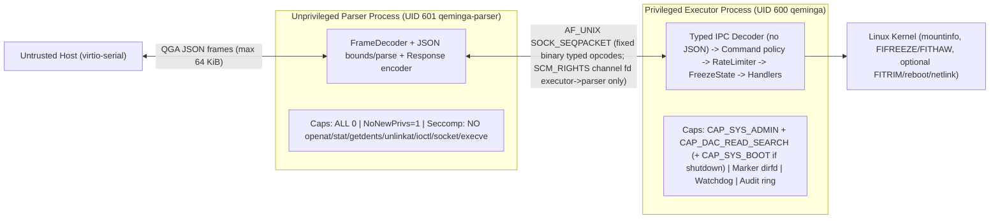

# Isolation Between the Host-Facing Parser and Guest Files (OQ-10)

> **Status:** Design decision for [#68](https://github.com/vicaya/qeminga/issues/68) (parent [#56](https://github.com/vicaya/qeminga/issues/56), `docs/tasks.md` OQ-10).
> **Scope:** Architectural design and verification plan. Implementation is sized in §7 and tracked as follow-up work once this design is accepted.

---

## 1. Problem Statement and Threat Model

In `v1`, `qeminga` runs as a single multi-threaded process after privilege drop (`docs/design.md` §5.4–§5.5, §5.9). That single process simultaneously:

1. Reads and parses adversarial host input from the virtio-serial channel (`/dev/virtio-ports/org.qemu.guest_agent.0`).
2. Holds `CAP_SYS_ADMIN` and `CAP_DAC_READ_SEARCH` (plus `CAP_SYS_BOOT` when `[features] shutdown = true`).
3. Retains file-read and file-write syscalls (`openat`, `read`, `pread64`, `readv`, `readlinkat`, `getdents64`, `write`, `writev`, `pwrite64`, `fsync`, `unlinkat`) in its seccomp-BPF filter.
4. Holds the writable virtio-serial descriptor back to the untrusted hypervisor.

No exploitable parser defect is claimed, and qeminga's safe-Rust bounds (`docs/design.md` §5.2, §5.6) make memory corruption unlikely. However, under a confidential VM (CVM) threat model where the host is untrusted and the defense-in-depth question is **"what happens if a defect compromises the process that parses host input?"**, `v1` cannot prevent a compromised parser from using `CAP_DAC_READ_SEARCH` + `openat`/`read` to read arbitrary guest files (including root-owned mode-`0600` secrets) and writing them to the host channel, nor from manipulating in-process freeze state, watchdogs, rate limiters, or audit records.

This document inventories the minimum authority each component actually needs, compares **Option A (single-process descriptor confinement)** against **Option B (two-process privilege separation with a small privileged typed executor)**, specifies Option B's typed protocol and lifecycle behavior, and defines concrete boundary tests.

---

## 2. Component Authority Inventory

Every operation in `qeminga` touches at most five authority domains. Splitting responsibilities by what each component genuinely requires reveals a clean separation:

| Component | Guest file contents | Mount metadata | Open descriptors | Freeze / thaw / kernel authority | Host channel |
|---|---|---|---|---|---|
| **Host-facing I/O & protocol parser** (framing, `0xFF` sentinel, JSON bounds/parse, QGA reply encoding, virtio disconnect drain) | **None.** Needs zero guest files (not config, not `/etc/os-release`, not `/proc`). | **None.** Never reads `/proc/self/mountinfo`, `/proc/self/fdinfo`, or `statfs`. | Only: the single open virtio-serial channel fd (received from executor), one pre-connected `AF_UNIX` `SOCK_SEQPACKET` IPC fd to the executor, and optional `stderr` for framing diagnostics. | **None.** Zero capabilities (`CapEff = CapPrm = CapBnd = CapInh = CapAmb = 0`), no `ioctl`, no `reboot`, no `sync`, no `socket`, no `openat`. | **Read/write** on the open channel fd only; cannot open device paths itself (reopen requests go to executor). |
| **Privileged policy & kernel executor** (config, `Command` allowlist & feature switches, rate limiter, `FreezeStateMachine`, `FreezeOp`, watchdog, marker, `fsfreeze`, optional `fstrim`/`shutdown`/`suspend`/inventory) | Reads `/etc/qeminga/config.toml` at startup; maintains the guest-configured recovery marker (`/run/qeminga/frozen`); reads `/etc/os-release` (or `/usr/lib/os-release`) only when `information = true`; writes `/sys/power/state` only when `suspend_ram = true`. Never needs arbitrary workload files. | Reads `/proc/self/mountinfo` (and bounded `/proc/self/fdinfo/<fd>` on Linux 5.4–5.7 when `information = true`); calls `fstat`/`statx(STATX_MNT_ID)` and (when `information = true`) `fstatfs(2)`. | Pinned `/run/qeminga` directory fd; held `O_RDONLY \| O_DIRECTORY` mount descriptors across `Freezing → Frozen → Thawing`; transient `O_PATH` descriptors for `fsinfo`; one IPC socket fd; `stderr` journald fd. Opens `channel_path` transiently only at startup and on authorized reconnect, then immediately closes its own copy after `SCM_RIGHTS` hand-off. | UID/GID `600` (`qeminga`), `CAP_SYS_ADMIN` + `CAP_DAC_READ_SEARCH` (+ `CAP_SYS_BOOT` only with `shutdown = true`), `ioctl(FIFREEZE/FITHAW)` (+ `FITRIM` with `fstrim = true`), `sync`/`reboot` (with `shutdown = true`), `socket(AF_NETLINK, SOCK_RAW\|SOCK_CLOEXEC, NETLINK_ROUTE)` (with `information = true`). | **Never parses host bytes and never writes directly to the channel.** Only passes a newly opened fd for the guest-configured `channel_path` to the parser via `SCM_RIGHTS`. |
| **Authoritative audit sink** (§9, §9.1) | None (writes structured JSON to inherited `stderr` / journald pipe, switching to the 64 KiB in-memory ring while frozen). | None. | Inherited `stderr` fd owned by executor's dedicated audit writer thread. | None. | None. |

Key observation: **no single component needs both untrusted host-input parsing and `CAP_DAC_READ_SEARCH` / `CAP_SYS_ADMIN` / guest filesystem access.** The host channel only needs to connect to the parser, while filesystem descriptors, mount metadata, capabilities, and stateful lifecycle invariants belong exclusively in the executor.

---

## 3. Comparison of Isolation Options

### 3.1 Option A: Single-Process Descriptor Confinement (`openat2` / Pre-Opened Fds / Landlock)

Option A keeps the parser and privileged handlers in one process and attempts to restrict file access using kernel path/descriptor restrictions: pre-opening fixed directories (`/run/qeminga`, `/etc/qeminga`) at startup, using `openat2(RESOLVE_BENEATH)`, and/or applying a Landlock LSM ruleset (`landlock_restrict_self`).

**Technical blockers and security limits on Linux 5.4+:**

1. **Kernel baseline mismatch (`docs/design.md` §8.5 requires Linux 5.4+):**
   - `openat2(2)` requires **Linux 5.6+**.
   - Landlock ABI v1 requires **Linux 5.13+** (and `CONFIG_SECURITY_LANDLOCK=y`, which is optional in custom guest kernels).
   - On Linux 5.4–5.12, Option A degrades to **zero additional confinement** beyond `v1`.
2. **`openat2(RESOLVE_BENEATH)` is unenforceable by seccomp-BPF inside a compromised process:**
   - `openat2(dirfd, pathname, struct open_how *how, size)` passes `resolve` flags through a user-space pointer. Seccomp-BPF cannot dereference pointers, so a compromised parser can simply pass `how.resolve = 0` or `dirfd = AT_FDCWD`.
   - Even if `openat` were removed and only pre-opened directory fds were used, `FIFREEZE`/`FITHAW` must open dynamically discovered mountpoints across `/` (including mounts attached after daemon startup). Holding a pre-opened `/` `dirfd` lets `openat2(root_fd, "etc/shadow", ...)` read any file under `/`.
   - Channel reconnect reopens `/dev/virtio-ports/org.qemu.guest_agent.0`, which udev creates as a symlink to `../vportXpY` — a `..` traversal that `RESOLVE_BENEATH` relative to `/dev/virtio-ports` rejects.
3. **Landlock (`Linux 5.13+`) still leaks guest metadata and cannot protect process integrity:**
   - Landlock separates `LANDLOCK_ACCESS_FS_READ_DIR` from `LANDLOCK_ACCESS_FS_READ_FILE`. Withholding `READ_FILE` on `/` while granting `READ_DIR` on `/` allows opening mountpoint directories for `FIFREEZE` while blocking regular-file reads under `/` — **only** in the CVM profile (`information = false`) and **only** on Linux 5.13+.
   - Even there, granting `READ_DIR` on `/` allows a compromised parser to enumerate **every directory and filename on the entire guest** (`getdents64`) and exfiltrate them over the host channel.
   - Reading `/proc/self/mountinfo` (required for every freeze/recovery) and `/etc/os-release` (when `information = true`) forces granting `READ_FILE` either on `/proc`/`/etc` (exposing `/etc/shadow`, SSH host keys, or `/proc/*/environ` via `CAP_DAC_READ_SEARCH`) or on inode-pinned file rules that break on atomic rename/package upgrade or per-process `/proc/self` lookup.
   - Most fundamentally, the compromised parser still shares an address space with `CAP_SYS_ADMIN`, `CAP_DAC_READ_SEARCH`, `ioctl(FIFREEZE/FITHAW)`, the marker fd, `FreezeStateMachine`, the watchdog timer, rate limiters, and the audit ring. It can bypass all command gates, hold filesystems frozen without arming the watchdog, suppress audit records, or corrupt `/run/qeminga/frozen`.

### 3.2 Option B: Two-Process Privilege Separation (Zero-Privilege Parser + Small Privileged Typed Executor)

Option B splits `qeminga` into two OS processes with disjoint address spaces, disjoint UIDs, disjoint capability sets, and disjoint seccomp-BPF filters, communicating strictly through a typed, bounded `AF_UNIX` `SOCK_SEQPACKET` socketpair:



- **Untrusted parser (`qeminga-parser`, UID/GID `601`):**
  - Spawned once at startup via `fork` + `execve` (before the executor installs its seccomp filter) with `O_CLOEXEC` on every executor descriptor so the parser inherits **zero** executor memory, **zero** ASLR layout, and **only** the IPC socket fd, the initial channel fd (if open), and `stderr`.
  - Runs as a dedicated account (`qeminga-parser`, UID/GID `601`, distinct from `qeminga` UID/GID `600`) so it has zero discretionary access to `/run/qeminga` (`0700 qeminga:qeminga`), `/dev/virtio-ports/org.qemu.guest_agent.0` (`0600 qeminga:qeminga`), or optional `/sys/power/state` (`0664 root:qeminga`).
  - Drops **all** capabilities (`CapEff = CapPrm = CapBnd = CapInh = CapAmb = 0`), sets `PR_SET_NO_NEW_PRIVS`, changes working directory to an empty read-only directory (or `/`), caps `RLIMIT_NOFILE`, and installs a **parser seccomp filter** that **omits all filesystem-opening, filesystem-mutation, socket-creation, process-execution, and kernel-ioctl syscalls** (`open`, `openat`, `openat2`, `creat`, `stat*`, `newfstatat`, `statx`, `getdents64`, `readlinkat`, `faccessat*`, `unlinkat`, `fsync`, `ioctl`, `socket`, `socketpair`, `connect`, `bind`, `listen`, `accept*`, `sendto`, `recvfrom`, `execve`, `execveat`, `reboot`, `sync`, `uname`, `statfs`, `fstatfs`).
  - The parser needs only: `read`/`write`/`readv`/`writev`/`close`, `recvmsg`/`sendmsg` (on its single pre-connected `SOCK_SEQPACKET` IPC fd, receiving `SCM_RIGHTS` channel fds), `ppoll`/`epoll_*`/`eventfd2`, `fcntl`, memory/thread/futex/clock/exit syscalls. (Because the executor owns `SIGTERM`/`SIGINT` handling and signals session end by closing the IPC socket, the parser does not even need a signal `socketpair`.)
- **Privileged executor (`qeminga`, UID/GID `600`):**
  - Retains the existing §5.4–§5.5 privilege drop and authority-derived seccomp filter (`CAP_SYS_ADMIN`, `CAP_DAC_READ_SEARCH`, optional `CAP_SYS_BOOT`; `execve`/`execveat` absent after startup; systemd `ProtectSystem=strict` + `ReadWritePaths=/run/qeminga` from #66; narrowed socket rules from #67).
  - Never parses JSON and never reads from or writes to the virtio channel (closes its copy of the channel fd immediately after handing it to the parser).
  - Independently enforces `Command::is_enabled(&authority)`, guest-owned freeze mount target policy (#63), per-class rate limits, freeze state machine, watchdog, recovery marker, and authoritative `command_received` audit records.

### 3.3 Property Matrix: What Each Option Actually Enforces

| Security property (assuming arbitrary code execution inside the host-facing parser) | `v1` (current single process + #66 + #67) | Option A (single-process `openat2` / Landlock) | Option B (two-process parser + typed executor) |
|---|---|---|---|
| **Works on full supported Linux 5.4+ baseline (§8.5)** | Yes | **No** (`openat2` needs 5.6+; Landlock needs 5.13+) | **Yes** (standard `AF_UNIX` `SOCK_SEQPACKET`, `SCM_RIGHTS`, seccomp-BPF) |
| **Confidentiality of root-owned `0600` guest secrets (CVM & inventory)** | **No** (`CAP_DAC_READ_SEARCH` + `openat`/`read` in parser) | Linux 5.4–5.12: **No**. Linux 5.13+ CVM: regular-file content under `/` blocked, `/proc` & `/etc` fragile | **Yes** — parser has UID `601`, zero caps, and no `openat`/`readlinkat`/`getdents64` syscalls |
| **Confidentiality of world-readable guest files & directory listings** | **No** | **No** (`READ_DIR` on `/` exposes all filenames) | **Yes** — parser cannot open or list any directory or file |
| **Integrity of ordinary guest files (incl. UID-600-writable files)** | Bounded by systemd `ProtectSystem=strict` (#66), except `/run/qeminga` | Linux 5.13+ only; still allows `/run/qeminga` | **Yes** — parser has no `openat`/`unlinkat`, distinct UID `601`, and zero write paths |
| **Integrity of `/run/qeminga/frozen` marker, `FreezeState`, watchdog, rate limiter, and audit trail** | **No** (all live in parser address space) | **No** (all live in parser address space) | **Yes** — all live exclusively in executor address space; parser cannot forge, cancel, or bypass them |
| **Enforcement of guest command allowlist & freeze target policy** | Bypassable after parser compromise | Bypassable after parser compromise | **Yes** — executor independently authorizes every typed operation against guest config |
| **Residual exposure if parser is compromised** | Full file read + channel exfil, marker/state tampering, `CAP_SYS_ADMIN` ioctls | Directory enumeration, state/watchdog/marker tampering, `CAP_SYS_ADMIN` ioctls | Only valid policy-authorized typed operations the host could already send (rate-limited and audited by executor), plus the tiny non-JSON binary IPC parser in executor |

---

## 4. Trusted Authorization and Typed IPC Protocol (Option B)

### 4.1 Wire Format and Strict Bounds

Communication over the `AF_UNIX` `SOCK_SEQPACKET` socketpair uses a minimal, non-recursive, versioned binary frame (`src/ipc.rs`):

```text
Request  := version(u8 = 1) | req_id(u64 LE) | opcode(u8) | payload(bounded bytes)
Response := version(u8 = 1) | req_id(u64 LE) | status(u8) | payload(bounded bytes)
```

- **Hard bounds:** Maximum IPC request message `64 KiB` (matching §5.10 frame bound); maximum IPC response message `256 KiB` (matching §5.10 inventory reply bound); maximum in-flight requests `8` (matching §5.10 session places; excess requests are rejected without allocating).
- **No JSON or recursive structures in the executor:** Every opcode has a flat, fixed schema parsed with explicit length checks and zero dynamic recursion. Any malformed version, unknown opcode, trailing bytes, or out-of-bounds length causes the executor to log a protocol violation (`ipc_protocol_violation`) and terminate the compromised parser child immediately.

### 4.2 Typed Operations (Explicitly Excluding General Proxies)

Every operation is a closed enum variant authorized independently by the executor against its own `Config::authority()`, `RateLimiter`, `FreezeStateMachine`, and guest target policy:

| Opcode | Request payload (parser → executor) | Executor authorization & target binding | Response payload (executor → parser) |
|---|---|---|---|
| `Ping` | empty | Rate limit (`PingSync`), audit | `OkEmpty` |
| `Info` | empty | Rate limit (`PingSync`), audit | Static `Vec<(CommandId, enabled, success_response)>` derived from executor's `Config::authority()` |
| `Sync { id: i64 }` | `i64` | Rate limit (`PingSync`), audit | `OkI64(id)` |
| `SyncDelimited { id: i64 }` | `i64` | Rate limit (`PingSync`), audit | `OkI64(id)` (parser prefixes `0xFF`) |
| `FsfreezeStatus` | empty | Unlimited, watchdog heartbeat if `Frozen`, audit | `OkFreezeStatus(Thawed \| Frozen)` |
| `FsfreezeFreeze` | empty | Freeze gate, rate limit (`FsfreezeFreeze`), guest target allowlist (#63 if set), audit | `OkCount(u64)` or `Err(FixedErrorCode)` |
| `FsfreezeFreezeList` | `count(u16 <= 256)`, each `len(u16 <= 4096) + utf8 bytes` | Freeze gate, rate limit (`FsfreezeFreeze`), executor intersects with guest target allowlist (#63) **before** mountinfo lookup and verifies `st_dev` on `O_RDONLY \| O_DIRECTORY`, audit | `OkCount(u64)` or `Err(FixedErrorCode)` |
| `FsfreezeThaw` | empty | Unlimited, joins active `FreezeOp` or runs tracked/discovery drain, audit | `OkCount(u64)` or `Err(FixedErrorCode)` |
| `GetOsInfo` | empty | **Requires `authority.information`**, freeze gate, rate limit (`Get`), audit | Bounded `OsInfoDto` or `Err(Disabled \| Frozen \| ...)` |
| `NetworkGetInterfaces` | empty | **Requires `authority.information`**, freeze gate, rate limit (`Get`), audit | Bounded `Vec<InterfaceDto>` (loopback & link-local already stripped by executor) |
| `GetFsInfo` | empty | **Requires `authority.information`**, freeze gate, rate limit (`Get`), audit | Bounded `Vec<FsInfoDto>` (visible UTF-8 mounts with opaque `fs-N` IDs & `POLLPRI`-checked sizes) |
| `Fstrim { minimum: u64 }` | `u64` | **Requires `authority.trim`**, freeze gate, rate limit (`Fstrim`), audit | Bounded `Vec<TrimPathDto>` (fixed open-failure reasons) |
| `Shutdown { mode }` | `mode(u8: Powerdown \| Halt \| Reboot)` | **Requires `authority.reboot`**, freeze gate, rate limit (`Shutdown`), flush audit, `sync`+`reboot` | `OkSilent` (no reply on success) or `Err(...)` |
| `SuspendRam` | empty | **Requires `authority.suspend`**, freeze gate, rate limit (`Shutdown`), writes `/sys/power/state`, audit | `OkSilent` or `Err(...)` |
| `ReportParseRejection` | `kind(u8: Oversized \| ParseError \| UnknownMethod)`, bounded metadata | Rate-bounded executor audit record (§9); no kernel work | `OkAck` |
| `RequestChannelReopen` | empty | Executor enforces §5.7 reopen backoff (1 s → 30 s), opens **only** guest-configured `config.agent.channel_path`, checks `EBUSY` terminal rule (§8.4), sends single fd via `SCM_RIGHTS`, closes own copy | `OkChannelFd` (+ 1 `SCM_RIGHTS` fd) or `Err(RetryLater \| TerminalBusy)` |

**Explicitly excluded proxy anti-patterns:**
- **No path proxy:** There is no opcode that reads, stats, lists, opens, writes, or unlinks a parser-chosen path. `FsfreezeFreezeList` strings are strictly filtered by the executor's guest-owned policy and `FreezePlan::restrict_to` (only local ext4/xfs superblocks, `FIFREEZE` only) and never yield file contents or path names back to the parser.
- **No descriptor proxy:** No filesystem, `/proc`, marker, or netlink descriptor ever crosses IPC. `SCM_RIGHTS` flows strictly executor → parser and carries **only** the single virtio-serial channel fd opened from `config.agent.channel_path`. The executor rejects any `SCM_RIGHTS` ancillary data sent by the parser (`MSG_CMSG_CLOEXEC` + protocol violation kill).
- **No syscall / ioctl proxy:** No generic `ioctl`, `netlink`, `open`, or `signal` forwarding exists.
- **No arbitrary error strings in CVM mode:** Error responses carry a closed `ErrorCode` enum + counts (`u64`) + recovery-state enum, so the parser formats fixed QAPI strings (`docs/design.md` §5.9, AC27) and the executor never ships diagnostic strings containing guest paths or device numbers across the boundary.

---

## 5. Lifecycle, Mount Changes, Reconnect, Recovery, and Profile Differences

### 5.1 Mount Changes
All `/proc/self/mountinfo` snapshots, visibility resolution (`MountTree`), `O_RDONLY | O_DIRECTORY` opens, `fstat`/`statx(STATX_MNT_ID)` identity checks, `ppoll(POLLPRI)` namespace-change checks, and held frozen descriptors stay inside the executor. Mounts added, removed, or overmounted at runtime work identically to `v1` without granting the parser any filesystem visibility.

### 5.2 Channel Reconnect and Transport Reset
1. **Host disconnect without reset (`POLLIN | POLLHUP`, no `POLLOUT`):** Handled inside the parser on its existing channel fd (abandon undelivered replies, drain unread stale bytes to EOF/`EAGAIN`, `ppoll` backoff until `HostState::Ready`, matching §5.7). No executor call is needed.
2. **Deferred initial open, hot-unplug (`POLLHUP`), closed peer (`POLLERR`/`POLLRDHUP`), or `NeedsBoundary` transport reset:** The parser closes its stale channel fd and sends `RequestChannelReopen`. The executor opens `config.agent.channel_path` as UID `600` (`qeminga`), enforces backoff, returns the fd via `SCM_RIGHTS`, and closes its own copy.
3. **Terminal `EBUSY` (§8.4):** The executor detects `EBUSY` itself during open/reopen, closes the IPC socket to end the parser session, waits until `FreezeState == Thawed` (bounded by the watchdog if frozen), and exits with `EX_UNAVAILABLE` (69).

### 5.3 Recovery Marker, Watchdog, and Parser Crash Supervision
- **Startup recovery:** The executor checks `Marker::exists()` before spawning the parser, enters `Frozen` recovery mode, switches the audit router to ring mode, and arms the watchdog immediately (OQ-7, C-14) — completely independent of whether the parser or channel is ready.
- **Parser crash or seccomp kill while `Thawed`:** The executor observes `EOF` on the IPC socket, reaps the child, and exits non-zero so systemd restarts the service cleanly (`Restart=always`, fresh `execve` with new ASLR).
- **Parser crash or seccomp kill while `Freezing` / `Frozen` / `Thawing`:** The executor **never exits while filesystems may be frozen** (§5.7). It reaps the dead parser while keeping `FreezeState`, held descriptors, `/run/qeminga/frozen`, and the watchdog intact. Once the watchdog (or in-flight drain) completes the thaw and removes the marker, the executor exits and systemd restarts the pair cleanly. This keeps `execve`/`fork` completely absent from the executor's post-startup seccomp filter.
  - *(Optional future topology note: if a deployment ever requires instant parser respawn while `Frozen` ahead of the 30 s idle watchdog, the same IPC protocol can run across two companion systemd units — `qeminga.service` and `qeminga-parser.service` — connected via a private `0750 root:qeminga-parser` `SOCK_SEQPACKET` socket verified by `SO_PEERCRED`. The single-unit `fork`+`execve` `socketpair` topology is recommended as the baseline because it avoids `bind`/`listen`/`accept4`/`SO_PEERCRED` in the executor's seccomp filter and preserves single-unit packaging and `Conflicts=qemu-guest-agent.service`.)*
- **Executor crash (`SIGKILL`):** The parser observes IPC `EOF` and exits immediately; systemd restarts the service and `/run/qeminga/frozen` drives conservative marker recovery exactly as in `v1` (§4.4).

### 5.4 CVM vs. Opted-In Inventory Profiles
- **CVM / data-protection profile (`packaging/config-data-protection.toml`):**
  - Parser sandbox is identical: UID `601`, zero capabilities, zero filesystem syscalls.
  - Executor drops `CAP_SYS_BOOT`, omits `reboot`/`sync`/`uname`/`statfs`/`fstatfs`/netlink/`socket`/`FITRIM` from its seccomp filter, denies all inventory/trim/shutdown/suspend IPC opcodes with `ErrorCode::Disabled`, and emits only fixed enums and `u64` counts over IPC.
- **General-VM / opted-in inventory profile (`packaging/config.toml`):**
  - Parser sandbox remains **unchanged** (UID `601`, zero capabilities, zero filesystem syscalls). Even when `information = true`, a compromised parser still cannot read arbitrary guest files outside the explicitly authorized `OsInfo`/`Interface`/`FsInfo` projections collected and filtered by the executor.
  - Executor retains only the configured authority (`information`, `fstrim`, `shutdown`, optional `suspend_ram`) exactly as in §5.9.

---

## 6. Verifiable Boundary Test Specification

Before claiming OQ-10 isolation in any release, the implementation must pass four automated privileged / disposable-guest boundary tests against the real built binary under enforced hardening:

### Test Fixtures (present simultaneously in the guest)
1. **Synthetic guest secrets:**
   - `/var/lib/qeminga-boundary-test/root-secret` (`0600 root:root`, containing `"synthetic-root-secret-oq10"`).
   - `/var/lib/qeminga-boundary-test/world-secret` (`0644 root:root`, containing `"synthetic-world-secret-oq10"`).
2. **Unrelated writable files:**
   - `/tmp/qeminga-boundary-uid600` (`0600 qeminga:qeminga`, initial content `"untouched-uid600"`).
   - `/tmp/qeminga-boundary-world` (`0666 root:root`, initial content `"untouched-world"`).
3. **Authorized freeze targets:** Real loop-mounted `ext4` (and `xfs`) filesystems, including a mode-`0700 root:root` mountpoint to verify the executor's `CAP_DAC_READ_SEARCH` still opens protected mountpoints.

### Required Automated Checks
1. **Parser process credential & seccomp inspection:** Read `/proc/<parser_pid>/task/*/status` for every thread of the parser child and assert `Uid == 601`, `CapEff == CapPrm == CapBnd == CapInh == CapAmb == 0000000000000000`, `NoNewPrivs == 1`, `Seccomp == 2`, and open `/proc/<parser_pid>/fd` contains **only** stdin/stdout/stderr, the virtio channel, the single IPC socket, and epoll/eventfd descriptors (no marker dirfd, no mount fds, no `/proc/self/mountinfo`).
2. **Confidentiality boundary probe (synthetic secrets):** Execute a child test harness under the exact parser sandbox (UID `601`, zero caps, parser seccomp profile) attempting `openat` + `read` on both `root-secret` and `world-secret`, `/etc/qeminga/config.toml`, `/proc/self/mountinfo`, and `getdents64` on `/var/lib/qeminga-boundary-test`. Every attempt must terminate with `SIGSYS` under enforced seccomp (and, in a companion without-seccomp check of the UID/capability layer, `root-secret` and `/run/qeminga` must fail with `EACCES`).
3. **Integrity boundary probe (unrelated writable files & marker):** Under the same parser sandbox, attempting `openat(O_WRONLY)` or `unlinkat` on `/tmp/qeminga-boundary-uid600`, `/tmp/qeminga-boundary-world`, and `/run/qeminga/frozen` must terminate with `SIGSYS` (and fail with `EACCES`/`EROFS` at the UID/unit layer). Simultaneously, a mock compromised parser sending unauthorized IPC opcodes (`GetFsInfo`, `Shutdown`, `Fstrim` under CVM; `FsfreezeFreezeList` outside a configured guest allowlist; malformed frames; unexpected `SCM_RIGHTS`) must be rejected by the executor with zero kernel side effects and intact `FreezeState`.
4. **Authorized freeze/thaw + recovery cycle alongside intact fixtures:** Over the real channel with both secrets and both unrelated writable files present, complete:
   - `guest-ping` → `{}`
   - `guest-fsfreeze-freeze-list` on the real `ext4`/`xfs` (including the `0700` mountpoint) → exact nonzero count, `/run/qeminga/frozen` created by UID `600`
   - `SIGKILL` the parser child while `Frozen` → verify executor keeps `Frozen` state + marker + watchdog running and autonomously thaws at idle expiry (or recovers on restart), removing `/run/qeminga/frozen` and making the loop filesystems writable again
   - Repeat a normal freeze → `guest-fsfreeze-thaw` → verify count matches, marker removed, and assert `root-secret`, `world-secret`, `/tmp/qeminga-boundary-uid600`, and `/tmp/qeminga-boundary-world` have identical bytes, inode, and mtime.

---

## 7. Decision and Implementation Sizing

- **Selected design (OQ-10):** **Option B — two-process privilege separation** (zero-capability, zero-filesystem `qeminga-parser` child spawned via `fork` + `execve` at startup over a point-to-point `AF_UNIX` `SOCK_SEQPACKET` socketpair, backed by the privileged `qeminga` typed executor). Option A is rejected because it cannot protect Linux 5.4–5.12 guests, leaks directory listings even on Linux 5.13+, and leaves capabilities, watchdog, marker, and command policy inside the compromised parser's address space.
- **v1 status:** Until Option B is implemented, `v1` retains the single-process architecture with its residual authority stated explicitly in `docs/design.md` §5.9 and `packaging/README.md` (#65), hardened by systemd write confinement (#66) and narrowed seccomp socket rules (#67).
- **Sized follow-up implementation tasks (to be scheduled separately):**
  1. **IPC codec & fuzz target (~M):** Add `src/ipc.rs` binary typed request/response codec with hard size/count bounds, `proptest` round-trip tests, and a `cargo fuzz` target; add zero-filesystem parser seccomp profile in `src/seccomp.rs` + cBPF tests.
  2. **Process split, channel `SCM_RIGHTS`, and supervision (~M):** Add `qeminga-parser` (`601:601`) to `packaging/sysusers.d/qeminga.conf`, spawn parser via `fork` + `execve` (`--internal-parser-fd`) before executor seccomp installation, wire `RequestChannelReopen` (`SCM_RIGHTS` executor → parser only), and preserve watchdog thaw on parser crash while `Frozen`.
  3. **Boundary verification suite (~S–M):** Implement the four verifiable boundary tests of §6 in `tests/privileged_e2e.rs` and disposable-guest smoke coverage on both `x86_64` and `aarch64`.
